<picture>
  <source media="(prefers-color-scheme: dark)" srcset="assets/hero-dark.svg">
  
</picture>

スタートアップでCTO・CPOとしてプロダクトを立ち上げてきました。いまは社外CTO・技術顧問として開発を支援しながら、[MEEQUS](https://meequs.com/) でAI開発の周辺作業を自動化するプロダクトを作っています。

**得意なこと** AI活用 / エンジニアリング / プロダクトグロース / 組織づくり

**関わった領域** インターネットメディア · 教育・福祉 · 金融 · MaaS · IoT · モバイルゲーム · ライフサービス · ネットワークインテグレーター

## Building at MEEQUS

AI開発の面倒な部分を自動化し、誰もが10倍速で開発できる世界をつくる。セットアップ、監視、ドキュメント整理などの周辺作業を、少人数とAIエージェントで形にしています。

| 分野 | プロダクト |
|------|-----------|
| 開発支援 | [Autopilot](https://meequs.com/products/autopilot) · [SkillForge](https://meequs.com/products/skillforge) · [FlowCapture](https://meequs.com/products/flowcapture) · [AI Guardlet](https://meequs.com/products/ai-guardlet) |
| 診断・アセスメント | [IdeaLoop](https://meequs.com/products/idealoop) · [RoleLens](https://meequs.com/products/rolelens) · [Hearect](https://meequs.com/products/hearect) |
| メディア | [Vizora](https://meequs.com/products/vizora)（有価証券報告書を図解する企業データベース） |
| ツール | [Emoji Studio](https://emoji.meequs.com/) · [DotCat](https://cat-play.meequs.com/) · [Git Trainer](https://meequs.com/products/git-trainer) |

全プロダクトは [meequs.com](https://meequs.com/) にまとめています。

## Open source

| プロジェクト | 内容 |
|-------------|------|
| [flappy-bird-tui](https://github.com/takish/flappy-bird-tui) | ターミナルで遊べる Flappy Bird（Go） |
| [git-trainer](https://github.com/takish/git-trainer) | Git/GitHub の基本操作を安全な疑似環境で学べる TUI ゲーム |
| [packet-monitor-pcap](https://github.com/takish/packet-monitor-pcap) | libpcap ベースのクロスプラットフォームなパケットモニター（Linux / macOS） |
| [homebrew-tap](https://github.com/takish/homebrew-tap) | 上記ツールの Homebrew tap |

```sh
brew install takish/tap/flappy-bird-tui
```

## Links

[経歴の詳細（Notion）](https://takish.notion.site/Profile-Takashi-Kishida-f630cf5ea7294ad89c4fb83aa5629c20) · [MEEQUS](https://meequs.com/) · [代表プロフィール](https://meequs.com/about/)
